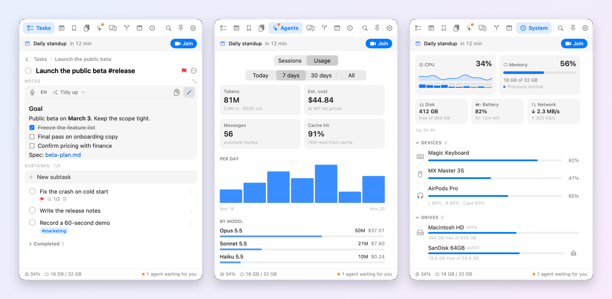
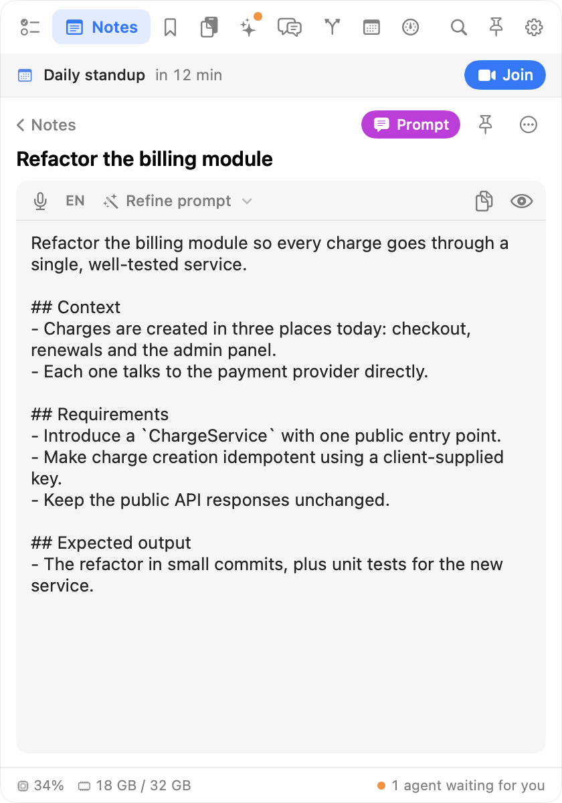
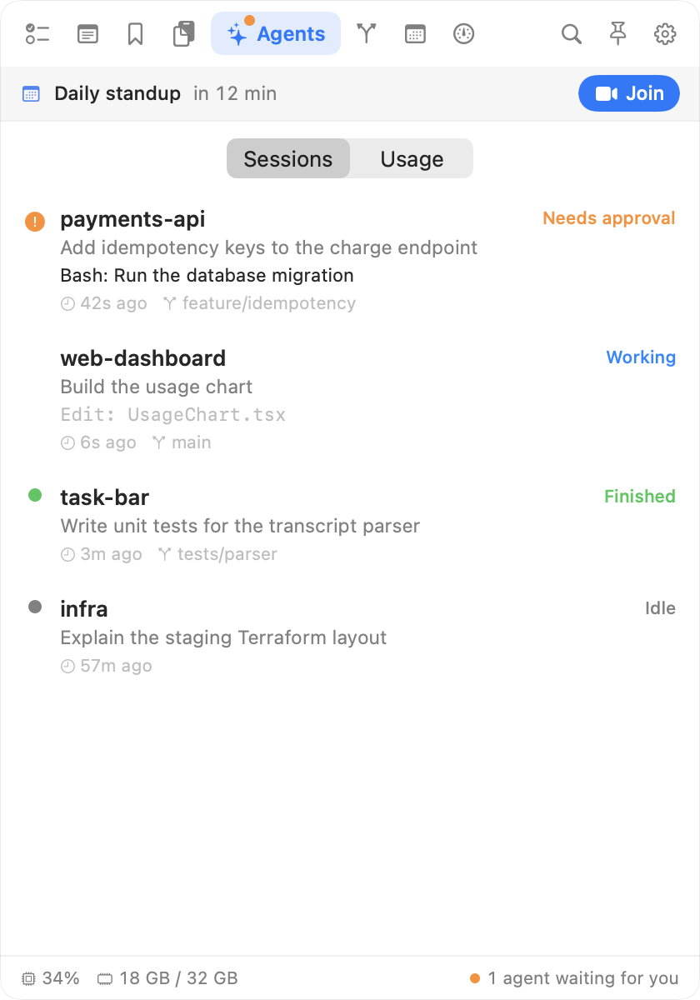
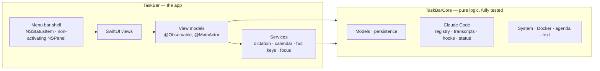

<div align="center">

# TaskBar

**A featherweight macOS menu bar companion for people who live in their terminal.**

Nested tasks · notes you can dictate · a live view of your Claude Code agents · your calendar · your Mac's vitals.
One popover that opens when you hover the menu bar. No Dock icon, no account, no API key.

[](https://github.com/thomazzi98/task-bar/actions/workflows/ci.yml)


[](LICENSE)

<picture>
  <source media="(prefers-color-scheme: dark)" srcset="docs/screenshots/banner-dark.png">
  
</picture>

</div>

## Why

Small things pile up while you work: a task you must not forget, a link, an idea for a prompt, an agent
that has been waiting ten minutes for you to approve a command. TaskBar keeps all of that one glance
away, and gets out of the way the moment you look elsewhere.

It is built to be **light enough to forget it is running**: a 6 MB native app with zero third-party
dependencies that does no work at all while its popover is closed.

## Features

### Tasks that nest as deep as you need

- Type a task, press <kbd>Return</kbd>. Check it off when it is done.
- Click a task to step inside it: a roomy notes pad on top, subtasks below.
  Every subtask opens the same way, to any depth, with a breadcrumb to find your way back.
- Priorities, `#tags` typed straight into the title, drag to reorder, and a collapsed list of completed work.

### Notes and prompt drafts — type them or say them



- Notes are separate from tasks: no checkbox, no hierarchy, just a place to think.
- **Dictate** with the microphone button. Speech is transcribed **on your Mac** by Apple's speech
  model; audio never leaves the machine.
- **Tidy up** fixes transcription mistakes, removes filler and organizes the text into clean Markdown.
  You review the rewrite and choose to apply or discard it, and one click restores the original.
- Mark a note as a **Prompt** and the same button becomes **Refine prompt**: it turns a rambling,
  spoken idea into a clear, structured prompt ready to paste into Claude Code or any other AI tool.
- Markdown preview with clickable links and checkboxes you can tick.

<br clear="right">

### Your Claude Code agents at a glance



- Every Claude Code session on your Mac, with its project, what it is doing, and its last messages.
- A status you can trust: **Working**, **Needs approval**, **Needs your answer**, **Finished** or **Idle**.
- The menu bar icon shows an **amber dot** the moment an agent is blocked on you, and a green one
  when a turn finishes that you have not seen yet.
- Click an agent for the recent conversation, then **Focus window** to jump to the exact terminal
  tab or editor window it runs in.

<br clear="right">

### Calendar, system, containers

- **Calendar** — today and the coming week, with a **Join** button for Meet, Zoom and Teams links, and
  a "next up" strip while a meeting is near. Reads the calendars already on your Mac, so Google
  Calendar works without OAuth setup.
- **System** — CPU (with per-core bars), memory pressure, disk, battery and network; open apps and
  top processes with one-click quit; Docker containers with start, stop, restart and clickable ports.
  - **Devices** — battery of connected keyboards, mice, trackpads and headphones (Apple devices,
    AirPods, and Bluetooth LE devices such as Logitech keyboards through the standard battery service).
  - **Drives** — every mounted volume, USB sticks included, with free space; click to open it in
    Finder, one click to eject.
  - **Ports** — every listening TCP port with its process and PID, the service it most likely is
    (Vite, Node, PostgreSQL, Redis, MongoDB…), an **Open** button for web servers and a stop button
    that asks first. Doubles as a quick check of which local databases are up.

### Links, clipboard, Git and usage

- **Links** — folders of bookmarks with a color and an icon. Paste a link to add it; one click opens it.
- **Clipboard** — history of what you copied, searchable, with pins. One click copies an item again.
  Items that password managers mark as secret are never recorded, and the history can be turned off.
- **Git** — the repositories of your Claude Code sessions plus any you add: branch, ahead/behind,
  pending changes, recent commits, branches and, with the GitHub CLI (`gh`), open pull requests.
- **Usage** (in Agents) — Claude Code tokens, estimated cost at API list prices, cache hit rate, and
  the breakdown by model, project and session for today, 7 days, 30 days or all time.

## Light by design

Measured on an Apple silicon MacBook running macOS 26, release build:

| State | CPU | Memory footprint |
| --- | --- | --- |
| Popover closed | **0.0%** | **22 MB** |
| Popover open, any tab | 1% or less | 25 to 31 MB |

How it stays there:

- **Nothing is sampled while the popover is closed.** Agent status arrives through file-system
  events and Claude Code hooks, not polling. CPU, memory, processes and containers are only read
  while you are looking at them; the same goes for devices, drives, ports, Git and token usage. Two
  light timers run while closed: a coalesced pointer check, four times a second, that backs up hover
  detection until the menu bar's own tracking has fired once, and, while clipboard history is on, a
  check of the pasteboard's change counter twice a second (the contents are read only when it moves).
- **Transcripts are read from the tail.** Session logs reach tens of megabytes; TaskBar reads the last
  few hundred kilobytes and re-reads only when a file changes. Scanning four sessions with 28 MB of
  logs takes about 12 ms.
- **No per-frame work.** Live gauges redraw once per sample, and the one looping animation runs in
  the window server through Core Animation rather than in the app.
- **No dependencies.** Only system frameworks, including a small Unix-socket HTTP client for the
  Docker API instead of a networking library.

## Install

Requirements: macOS 14 or later and the Swift 6.2 toolchain (Xcode 26 or its command line tools).
On-device dictation with the newest speech model and the on-device "Tidy up" need macOS 26.

```sh
git clone https://github.com/thomazzi98/task-bar.git
cd task-bar
make install        # runs the tests, builds TaskBar.app and copies it to /Applications
```

Prefer to try it first? `make run` builds into `dist/` and launches it from there.

Because you build it yourself, macOS does not quarantine the app. It is signed ad hoc; see
[Signing](#signing) if you want privacy permissions to survive rebuilds.

## Using it

### Opening and closing

| Action | Result |
| --- | --- |
| Rest the pointer on the menu bar icon | Opens without taking keyboard focus |
| Click the icon, or press <kbd>⌃</kbd><kbd>⌥</kbd><kbd>T</kbd> anywhere | Opens ready for typing |
| Move the pointer away | Closes, if you only looked |
| Click inside, or start typing | Stays open until <kbd>Esc</kbd>, a click on the icon, or a click elsewhere |
| Click the pin | Stays open until you close it |

That last rule matters when writing: once you are typing a note the popover never disappears just
because the pointer wandered off.

### Keyboard

| Shortcut | Action |
| --- | --- |
| <kbd>⌃</kbd><kbd>⌥</kbd><kbd>T</kbd> | Show or hide TaskBar (global, configurable) |
| <kbd>⌃</kbd><kbd>⌥</kbd><kbd>V</kbd> | New note by voice: opens a note and starts dictating (global, configurable) |
| <kbd>⌘</kbd><kbd>1</kbd> … <kbd>⌘</kbd><kbd>9</kbd> | Switch tab |
| <kbd>⌘</kbd><kbd>N</kbd> | New task or note |
| <kbd>⌘</kbd><kbd>F</kbd> | Search every task, subtask and note |
| <kbd>⌘</kbd><kbd>P</kbd> | Pin or unpin |
| <kbd>⌘</kbd><kbd>,</kbd> | Settings |
| <kbd>Esc</kbd> | Step back one level, then close |

Global shortcuts use the system hot-key API, so they need no Accessibility permission.

### Dictation and "Tidy up"

Dictation always runs on-device. "Tidy up" is optional and uses whichever model is available:

| Engine | Needs | Notes |
| --- | --- | --- |
| **Apple Intelligence** | macOS 26 with Apple Intelligence turned on | On-device, free, offline. Used first when available. |
| **Claude, through Claude Code** | Claude Code installed and signed in | Runs `claude -p` with a small model. Uses your existing login, so there is no key to paste. No tools, no hooks, no saved session. |

If neither is available the button explains why, and everything else keeps working.
**TaskBar never requires an API key.**

### Claude Code hooks

Without any setup TaskBar already lists your sessions and knows whether each is busy or idle, by
reading the session registry and transcripts under `~/.claude`.

Hooks make it **instant and precise**: Claude Code tells TaskBar the moment it asks for permission.
Install them with one click in **Settings › Claude Code › Install**, or from a terminal:

```sh
/Applications/TaskBar.app/Contents/MacOS/TaskBar --install-hooks     # --uninstall-hooks reverses it
```

The installer merges into `~/.claude/settings.json`, keeps every hook you already have, and saves a
timestamped backup first. It registers one tiny relay script for these events:

```jsonc
{
  "hooks": {
    "PermissionRequest": [
      { "hooks": [{ "type": "command", "async": true,
                    "command": "\"$HOME/Library/Application Support/TaskBar/hooks/taskbar-hook.sh\"" }] }
    ],
    "PostToolUse": [
      { "hooks": [{ "type": "command", "async": true,
                    "command": "\"$HOME/Library/Application Support/TaskBar/hooks/taskbar-hook.sh\" lite PostToolUse" }] }
    ]
    // …and Notification, Stop, UserPromptSubmit, SessionStart, SessionEnd,
    //    PermissionDenied, PostToolUseFailure. Print them all with --print-hook-settings.
  }
}
```

The [relay script](Sources/TaskBarCore/Claude/HookInstaller.swift) is about thirty lines of POSIX
shell. It writes the event to a spool folder that TaskBar watches. No network, no daemon. Every hook
is `async`, so it never slows Claude Code down, and it exits immediately when TaskBar is not running.
For events with large payloads it forwards only the session ID.

<details>
<summary>How a session's status is decided</summary>

Three signals are merged, because each one alone is incomplete:

| Signal | Strength | Weakness |
| --- | --- | --- |
| Hook events | Instant, and they say exactly which tool is asking | Optional; there is no "permission granted" event |
| Session registry (`~/.claude/sessions`) | Always there; reports busy, idle and waiting | Coarse; an internal format, parsed defensively |
| Transcript tail | Knows which tool call has no result yet | Written with a delay |

`PermissionRequest` flips a session to **Needs approval** immediately. It is cleared by the next hook
event from that session, or as soon as the registry moves on, which catches the case of approving a
command that then runs for minutes. An unanswered `AskUserQuestion` or plan review in the transcript
means **Needs your answer**. A turn that ended after TaskBar last showed you the list is **Finished**.

The whole decision is one pure function,
[`AgentStatusResolver`](Sources/TaskBarCore/Claude/AgentStatus.swift), covered by a table of tests.

</details>

### Calendar

TaskBar reads the calendars macOS already syncs. To see Google Calendar, add your Google account once
in **System Settings › Internet Accounts** and enable Calendars. Events are read-only.

### Automation

Any tool that can open a URL can drive TaskBar: Shortcuts, Raycast, Alfred, a shell script.

| URL | Effect |
| --- | --- |
| `taskbar://toggle`, `taskbar://open`, `taskbar://close` | Show or hide the popover |
| `taskbar://tab/agents` | Open on a tab: `tasks`, `notes`, `links`, `clipboard`, `agents`, `git`, `calendar`, `system` |
| `taskbar://new-task?title=Call%20the%20bank` | Add a task without opening anything |
| `taskbar://new-note?text=…` | Add a note |
| `taskbar://new-prompt?text=…` | Add a prompt draft |

```sh
open -g "taskbar://new-task?title=Review%20the%20release%20notes"
```

URLs can only show the app or add content. Nothing can be deleted or read through them.

## Privacy and data

Everything stays on your Mac. The exceptions are "Tidy up" with the Claude engine, which sends the
note you asked to rewrite through your own Claude Code login, and the Git tab's pull requests, which
the GitHub CLI fetches with your own `gh` login.

Your data is human-readable JSON in `~/Library/Application Support/TaskBar/`: `tasks.json`,
`notes.json`, `links.json`, `clipboard.json` (the clipboard history) and `git-repos.json`. A task looks like this:

```jsonc
// tasks.json
{
  "schemaVersion": 1,
  "tasks": [
    {
      "id": "F826650A-9E20-4412-93E9-1B21A0A597A0",
      "title": "Launch the public beta #release",
      "notes": "## Goal\nPublic beta on **March 3**.",
      "priority": "high",
      "isDone": false,
      "createdAt": "2026-11-18T15:47:26Z",
      "children": [ /* subtasks, same shape */ ]
    }
  ]
}
```

Writes are atomic, and a file that cannot be read is moved aside as `tasks.corrupt-<date>.json`
instead of being overwritten.

Permissions are requested only when you first use the feature that needs them:

| Permission | Asked when you | Used for |
| --- | --- | --- |
| Microphone | Start dictating | On-device transcription |
| Calendars | Click **Connect Calendar** | Reading upcoming events |
| Automation | Use **Focus window** on a Terminal or iTerm2 session | Selecting the right tab |
| Notifications | Turn on alerts in Settings | Agent and event reminders |
| Bluetooth | Open the System tab | Battery of Bluetooth LE keyboards and mice |

Nothing is requested at launch. Logs contain states and counts only, never the text of your tasks,
notes or prompts.

## Architecture

Two Swift Package Manager targets, with a strict direction of dependency:



```
Sources/
├── TaskBarCore/            No UI, no AppKit. Everything here is unit-tested.
│   ├── Models/             TaskItem, Note, AgentSession
│   ├── Persistence/        JSONFileStore, TaskTree (pure tree operations), AppPaths
│   ├── Claude/             SessionRegistry, TranscriptParser, AgentStatusResolver,
│   │                       AgentScanner, HookEvent, HookInstaller
│   ├── System/             SystemMetricsSampler, ProcessInspector, ProcessList
│   ├── Docker/             UnixSocketHTTP, DockerClient
│   ├── Agenda/             AgendaBuilder, MeetingLinkDetector
│   ├── Text/               TextPolisher, NoteChunker, MarkdownBlocks, ClaudeCLIPolisher
│   └── Support/            PopoverBehavior, DirectoryWatcher, Search, URLCommand
└── TaskBar/
    ├── App/                Entry point, composition root, settings
    ├── MenuBar/            StatusItemController, PopoverPanel
    ├── ViewModels/         One per tab, plus the dictation and rewrite assistant
    ├── Services/           Dictation, calendar, hot keys, window focus, notifications
    └── Views/              One folder per tab, plus shared components
```

A few decisions worth knowing about:

- **The popover's open/close rules are a pure state machine.**
  [`PopoverBehavior`](Sources/TaskBarCore/Support/PopoverBehavior.swift) knows nothing about AppKit.
  The controller feeds it events (pointer rested on the icon, became key, clicked outside) and
  performs the effects it returns. Hover, pin and focus rules are therefore covered by plain unit tests.
- **A non-activating panel instead of `MenuBarExtra`.** SwiftUI's `MenuBarExtra` cannot open on hover,
  and a regular window would steal focus from the app you are working in. The panel accepts typing
  without activating TaskBar.
- **Work stops outside SwiftUI.** A hidden window stops updating its views, so sampling is switched
  on and off by the composition root from the panel's real visibility, not by view modifiers.
- **The Claude Code integration assumes nothing.** The registry format is undocumented, so parsing is
  tolerant, and every signal is optional: with no hooks, or even no registry, the app degrades instead
  of breaking.

## Development

```sh
make test          # unit tests
make app           # test, build and assemble dist/TaskBar.app
make run           # build (skipping tests) and launch
make screenshots   # re-render docs/screenshots with sample data
make help          # everything else
```

The build is a [single script](scripts/build.sh): `swift build`, assemble the bundle, `codesign`.
There is no Xcode project, though opening `Package.swift` in Xcode works fine.

The tests (about 190) run in under a second and include the real hook relay script executed against a
throwaway home directory, and the socket client talking to an in-process server.

**Self-test commands.** The app binary doubles as a diagnostic tool that runs the same code as the UI:

```sh
TaskBar=dist/TaskBar.app/Contents/MacOS/TaskBar
$TaskBar --agents                              # the Claude Code sessions TaskBar sees
$TaskBar --system                              # one reading of CPU, memory, processes, Docker
$TaskBar --calendar                            # calendar access and upcoming events
$TaskBar --ports                               # listening TCP ports, their owners and scope
$TaskBar --drives                              # mounted volumes with free space and flags
$TaskBar --devices                             # connected peripherals and battery levels
$TaskBar --usage 7d                            # Claude Code token usage (today, 7d, 30d, all)
$TaskBar --git /path/to/repo                   # branch, changes, commits, branches, pull requests
echo "rough notes…" | $TaskBar --polish note   # run "Tidy up" from a pipe
$TaskBar --transcribe memo.m4a --locale pt-BR  # the dictation engine on an audio file
```

To see the live-data screens (System, Usage, Git, Links, Clipboard) rendered from your own Mac, run
the app through `open`, so macOS asks for Bluetooth on the app's behalf rather than the terminal's:

```sh
open -W -n dist/TaskBar.app --args --render-live /tmp/taskbar-live
```

**A scratch data folder.** Point the app somewhere else to experiment without touching your data:

```sh
TASKBAR_DATA_DIR=/tmp/taskbar-playground dist/TaskBar.app/Contents/MacOS/TaskBar
```

`TASKBAR_CLAUDE_DIR` (or Claude Code's own `CLAUDE_CONFIG_DIR`) does the same for `~/.claude`.

**Logs.**

```sh
log stream --level debug --predicate 'subsystem == "io.github.thomazzi98.taskbar"'
```

### Signing

macOS ties privacy permissions to the code signature. An ad-hoc signature changes with every build, so
macOS asks for the microphone and calendar again after a rebuild. To keep them, sign with an identity:

```sh
CODESIGN_IDENTITY="Apple Development: Your Name (TEAMID)" make app
```

## Roadmap

- Per-app volume mixer. Feasible on macOS 14.2+ with Core Audio process taps, but it means routing
  other apps' audio through TaskBar in real time, so it will ship as an opt-in experiment.
- Whisper as an alternative dictation engine.
- Due dates and reminders for tasks.
- Notarized releases and a Homebrew cask.

Ideas and pull requests are welcome; see [CONTRIBUTING.md](CONTRIBUTING.md).

## License

[MIT](LICENSE) © 2026 Rafael Thomazzi
